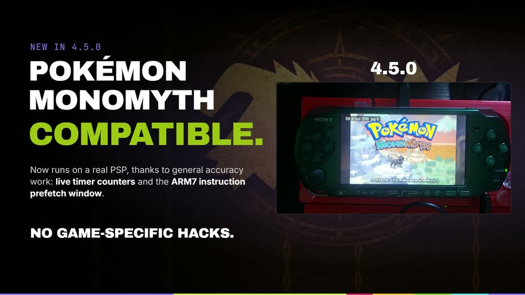
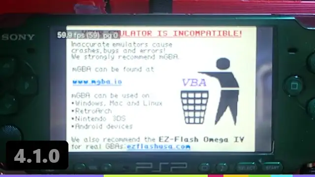
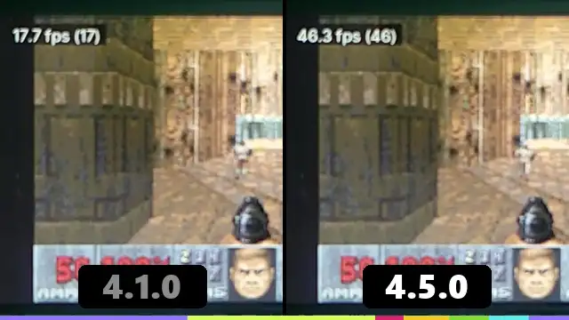
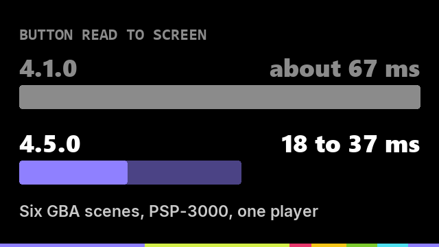
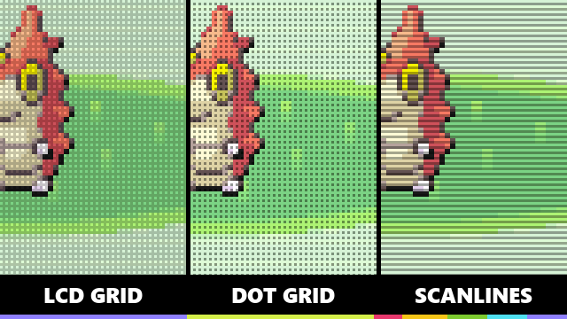
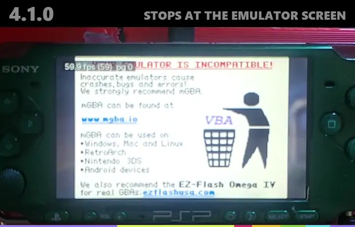
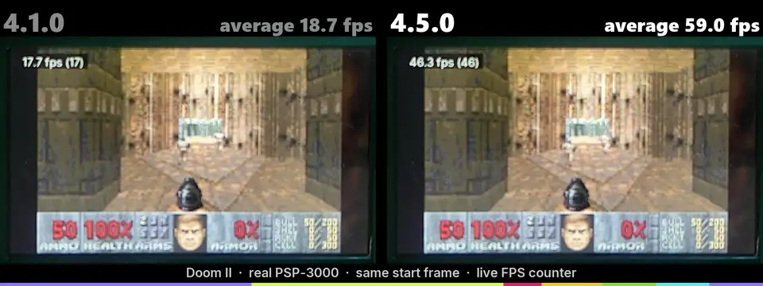
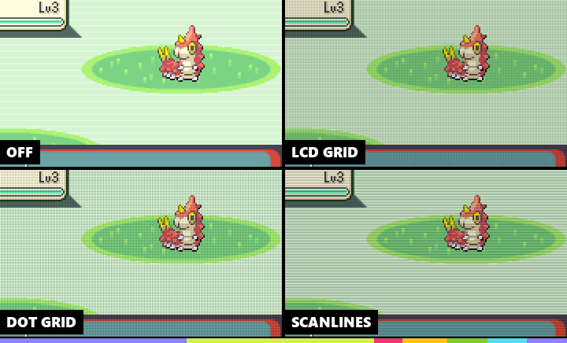
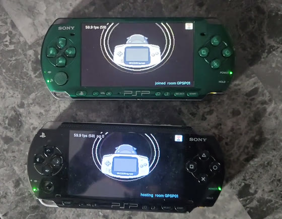

<!-- ============================================================================
     DRAFT for GBAdhoc 4.5.0. NOT published. Written from claude/rc-4.5.0 @ cf91ebe.
     Every number and claim is listed with its source in README-claims.md.

     MEDIA: built by the scripts in tools/ (see README-claims.md section 6).
     The hero clip, trailer copy and MonoMyth clips must be rebuilt from the final cuts.
     MEDIA-NEEDED: search this file. The XMB Photo column shot needs a console and the owner.

     VERSION: the release number is written ONCE, on the "Version" line in the
     hero block just below (4.5.0).  Every other sentence says "this release",
     apart from the before/after figures, which have to name 4.1.0 and 4.5.0.
     ============================================================================ -->
<p align="center">
  <picture>
    <source srcset="assets/gbadhoc-logo-3-dark@2x.png 2x, assets/gbadhoc-logo-3-dark.png 1x" media="(prefers-color-scheme: dark)">
    <source srcset="assets/gbadhoc-logo-3-light@2x.png 2x, assets/gbadhoc-logo-3-light.png 1x" media="(prefers-color-scheme: light)">
    
  </picture>
</p>

<h3 align="center">Game Boy Advance, Game Boy and Game Boy Color on your PSP,<br>and two PSPs that play together like two consoles and a link cable.</h3>

<p align="center">
  <sub><b>Version 4.6.0 beta 2</b> (pre-release; stable is 4.5.0) &nbsp;·&nbsp; PSP-1000, 2000/3000 and Go &nbsp;·&nbsp; no BIOS needed &nbsp;·&nbsp; GPL-2.0</sub>
</p>

<p align="center">
  <a href="https://github.com/ShoshinFauteux/GBAdhoc/releases/latest"><b>⬇&nbsp; Download the latest release</b></a>
  &nbsp;&nbsp;·&nbsp;&nbsp; <a href="gpsp/docs/video/trailer-4.5.0.mp4"><b>▶&nbsp; Watch the trailer</b></a>
  &nbsp;&nbsp;·&nbsp;&nbsp; <a href="#whats-new-in-this-release">What's new</a>
  &nbsp;&nbsp;·&nbsp;&nbsp; <a href="#install">Install</a>
  &nbsp;&nbsp;·&nbsp;&nbsp; <a href="#playing-together">Playing together</a>
  &nbsp;&nbsp;·&nbsp;&nbsp; <a href="#everything-it-does">Full feature list</a>
</p>

<p align="center">
  <a href="gpsp/docs/video/trailer-4.5.0.mp4">
  <picture>
    <source srcset="gpsp/docs/img/hero-450.webp" type="image/webp">
    
  </picture>
  </a>
  <br>
  <sub><b>Pokémon MonoMyth and Doom II on a real PSP-3000.</b> Click for the full trailer.</sub>
</p>

> **This is the `beta` branch: GBAdhoc 4.6.0 beta 2.**
> [Download it from the pre-release](https://github.com/ShoshinFauteux/GBAdhoc/releases/tag/v4.6.0-beta.2)
> (the *latest release* link above is the stable 4.5.0). What the beta adds:
>
> - **Wireless Adapter play is scheduled frame by frame.** Each PSP sends its frame's
>   adapter traffic with a marker and the other waits only when that marker is really
>   missing. Lag no longer builds up, and the 57 fps cap on wireless sessions is gone.
>   A beta links only with the same beta.
> - **Fire Emblem: The Morrow's Golden Country** boots, and its ~46 fps stutter is gone
>   (#10; fixes by Chandler Hardy, #26 and #27).
> - **Sleep after *Quit to game list*** no longer powers the PSP off (#28), and the
>   **PSP Go's slider** sleeps again during play.
> - **Settings → CPU clock** (333 MHz, 222 MHz or your CFW's own), **more ROM cache on the
>   PSP-1000**, and **mismatched builds are refused** before they link.
>
> Full notes and known issues: [CHANGELOG](gpsp/CHANGELOG.md). Everything below describes
> 4.5.0 unless it says otherwise.

**GBAdhoc is compatible with Pokémon MonoMyth.** The game turns away inaccurate
emulators such as VBA and tells you to use an accurate one like mGBA. This release passes
its accuracy check through general accuracy work, with no game-specific hacks.

It is also much faster. Across 46 test scenes from 36 games, the average frame rate is
**up 26.7%** on both the PSP-1000 and the PSP-3000, and Doom II now runs at about full speed on
average. There is lower input latency, a faster Game Boy core, Wireless Adapter
fixes, three new screen filters, and screenshots that save to the PSP's PICTURE folder.

Race a friend in Mario Kart, fight them in Advance Wars, trade Pokémon across Game Boy
generations: GBAdhoc still links two PSPs the way a cable links two Game Boys, and you can
still put the PSP to sleep and pick the game up tomorrow exactly where it was.

<br>

<table>
<tr>
<td colspan="2" width="33%" valign="top">

<b>Pokémon MonoMyth</b><br>
<sub>Compatible. It passes the game's accuracy check through general accuracy work, with no game-specific hacks.</sub>
</td>
<td colspan="2" width="33%" valign="top">

<b>Much faster GBA games</b><br>
<sub>Up 26.7% on average across the test suite, and 68% on the scenes that were struggling. Of the 18 scenes under 58 fps in 4.1.0, 5 still are.</sub>
</td>
<td colspan="2" width="33%" valign="top">

<b>Lower input latency</b><br>
<sub>Up to about three frames less between reading your buttons and showing the result in lighter GBA games.</sub>
</td>
</tr>
<tr>
<td colspan="3" valign="top">

<b>New screen filters</b><br>
<sub>LCD grid, dot grid and scanlines, per console, lined up with the game's own pixels.</sub>
</td>
<!-- MEDIA-NEEDED: a "Better screenshots" tile, once the XMB shot exists. With six tiles, go back to three cells per row. -->
<td colspan="3" valign="top">

<b>Faster Game Boy trades</b><br>
<sub>Crystal trades between two PSPs rose from about 50 fps to 58, Red from 55 to 59.</sub>
</td>
</tr>
</table>

---

## What's new in this release

Everything below is new since 4.1.0, the last stable release. The fixes from the 4.1.1
beta are included. Each item carries a <kbd>NEW</kbd> mark so you can tell it from the
features that were already there.

### <kbd>NEW</kbd> Pokémon MonoMyth

<p align="center">
  
</p>

Pokémon MonoMyth refuses to run on inaccurate emulators such as VBA and points you to an
accurate one like mGBA. **GBAdhoc is compatible with it.** On a real PSP, 4.1.0 lands on the game's
"emulator is incompatible" screen; this release passes the check and plays on through the intro, the first battles and picking your starter.

**There are no game-specific hacks.** Nothing in GBAdhoc looks for MonoMyth. It passes
because the emulator now behaves more like a real GBA in the places the game probes, and
every game gets the same fixes:

- **Live timer counters.** Reading a hardware timer now returns its count at that moment.
  The old core could only give the value from the last time it caught up.
- **The ARM7 instruction prefetch window.** A real GBA has already fetched the next two
  instructions, so code that overwrites them doesn't change what runs next. GBAdhoc now
  gets that right.
- **Branch timing.** A branch into RAM or the BIOS now costs what it costs on hardware.

### <kbd>NEW</kbd> Much faster GBA games

<p align="center">
  
</p>

Some GBA games rewrite their own code while they run. GBAdhoc translates GBA code into PSP
code once and reuses the result, so each rewrite used to mean throwing translations away
and paying for them again. This release throws away only what changed, reuses translations
it has already made, and patches a changed number straight into the translated code.

Measured on a real PSP-3000 at Fit, sharp bilinear and Ambient bars from the game's art,
with the FPS counter on:

| Game | 4.1.0 | 4.5.0 |
|---|---|---|
| Doom II | 18.7 fps | **59.0** |
| Back to Stone | 17.8 | **59.6** |
| Duke Nukem Advance | 17.5 | **57.8** |
| FIFA 07 | 21.8 | **59.5** |
| Ice Nine | 24.6 | **58.5** |

<sub>A full-speed GBA game reads about 59.7 here. These are 2400-frame runs of one saved
scene per game, shorter than the benchmark runs below, so the two sets differ a little,
most of all Ice Nine on 4.1.0. A different level can run faster or slower.</sub>

Across the whole test suite (46 scenes from 36 games, on a PSP-1000 and a PSP-3000, each
scene run twice per version in A-B-B-A order):

- **Average frame rate is up 26.7%** on both consoles, and **68% on the scenes that were
  struggling** (under 58 fps in 4.1.0). About **25% less CPU work** per frame.
- **Of the 18 scenes under 58 fps in 4.1.0, 5 still are:** Hot Wheels: Stunt Track
  Challenge (49.4), Top Gear Rally (56.4), LEGO Drome Racers (about 56.7), Duke Nukem
  Advance (about 57.7) and Payback (6).
- **Scenes that were above 58 fps in 4.1.0 stay where they were,** within about 0.15 fps.

<details>
<summary><b>The full table:</b> the games that changed most, on both consoles</summary>

These runs are at 1x with no filtering, two runs per version per console.

| Game | PSP-3000: 4.1.0 → 4.5.0 | PSP-1000: 4.1.0 → 4.5.0 |
|---|---|---|
| Doom II | 18.7 → **59.5** | 18.4 → **59.1** |
| Back to Stone | 18.2 → **59.7** | 18.1 → **59.7** |
| Duke Nukem Advance | 17.2 → **57.9** | 17.1 → **57.6** |
| FIFA 07 | 21.7 → **59.6** | 21.7 → **59.6** |
| Ice Nine | 22.1 → **58.3** | 21.9 → **58.2** |
| Smashing Drive | 29.9 → **59.7** | 29.8 → **59.7** |
| SSX 3 | 35.5 → **59.6** | 35.3 → **59.6** |
| Kill.Switch | 36.3 → **58.4** | 36.1 → **58.3** |
| Need for Speed: Most Wanted | 38.1 → **59.7** | 38.0 → **59.7** |
| Need for Speed: Carbon – Own the City | 42.9 → **59.7** | 42.9 → **59.7** |
| Max Payne | 50.0 → **59.7** | 49.2 → **59.6** |
| Ford Racing 3 | 54.9 → **59.7** | 55.0 → **59.7** |
| Mario Tennis: Power Tour | 56.9 → **59.7** | 56.8 → **59.6** |
| LEGO Drome Racers | 50.7 → **56.6** | 51.0 → **56.8** |
| Top Gear Rally | 49.4 → **56.4** | 49.6 → **56.4** |
| Hot Wheels: Stunt Track Challenge | 42.2 → **49.4** | 42.3 → **49.4** |
| Payback | 0.8 → **6.1** | 0.8 → **6.0** |

</details>

**Games that now run.** Need for Speed: Underground used to hang at its language screen. Big
Mutha Truckers and Street Racing Syndicate used to stop with an emulation error. All three
now run, and so does OpenLara. In our test scenes, on both consoles: Underground at 59.7 fps
in a race, Big Mutha Truckers at 59.7, Street Racing Syndicate at 59.5, OpenLara at 59.3.

Speed changes were checked frame by frame, with sound, against a slow reference emulator on
up to 48 game scenes, then measured on real PSPs. Three long-standing bugs inherited from the
original core turned up along the way and are fixed.

### <kbd>NEW</kbd> Lower input latency

Issue [#11](https://github.com/ShoshinFauteux/GBAdhoc/issues/11) asked why GBA games felt
slower to respond than Game Boy games. The finished picture sat in a queue for longer than
it had to, and that queue is now much shorter: GBAdhoc hands the picture to the screen
sooner, and takes it straight from the second processor when the frame has room.

Time from the emulator reading your buttons to that frame reaching the screen, one player:

| Game | 4.1.0 | 4.5.0, PSP-3000 | 4.5.0, PSP-1000 |
|---|---|---|---|
| Fire Emblem: The Sacred Stones | about 67 ms | **18 ms** | **20 ms** |
| Advance Wars 2 | about 67 ms | **21 ms** | **21 ms** |
| Pokémon Emerald, battle | about 67 ms | **21 ms** | **23 ms** |
| Need for Speed: Underground 2 | about 67 ms | **28 ms** | **28 ms** |
| Pokémon Heart & Soul, heaviest battle | about 67 ms | **32 ms** | **32 ms** |
| Pokémon Unbound, rival battle | about 67 ms | **37 ms** | **39 ms** |
| Pokémon Crystal (Game Boy Color) | about 33 ms | **17 ms** | **17 ms** |

- The buttons are also read later now, just before the frame starts. On real PSPs the pad
  sample used to be about 16 ms old by the time GBAdhoc read it, and it is now under 1 ms
  old. That comes on top of the table above.
- Light games wait up to about a millisecond a frame for that fresh sample. They spend a
  little more of each frame waiting, and they still run at full speed.
- These figures come from the emulator's own timing logs, not from a camera, and they are
  for one player. Link sessions are not faster in this release, and this is not a
  link-latency improvement.

### <kbd>NEW</kbd> Wireless Adapter fixes

Link Cable play is in great shape. The Wireless Adapter path still needs work, and more is
coming in following updates. These fixes are a first step:

- **The adapter works after a cable session.** A link-cable session used to leave the game
  with no adapter until the next launch. On two real PSPs, a Union Room session right after
  a cable session failed both runs before this fix and passed both after it.
- **When the host leaves, the other PSP finds out.** A host that crashed, slept, walked out
  of range or quit could leave the other game waiting for good.
- **A closed room is closed.** A game that stops hosting now leaves the room list and refuses
  newcomers, as the real adapter does.
- **No phantom players.** A connection that arrived after the game had given up used to hold
  a player slot for about four seconds.
- **Less lag piles up on the joining PSP** in Mario Golf: Advance Tour and Mario Tennis:
  Power Tour, which send data every frame. GBAdhoc now drops what the real adapter would have
  overwritten. Both games still struggle over the adapter; see
  [known limitations](#status-and-known-limitations).

### <kbd>NEW</kbd> Faster Game Boy and Game Boy Color

The Game Boy core now brings its timer up to date only when a game looks at it, and two
linked PSPs run more of each frame in one go instead of stopping to line the games up.

| Pokémon trade between two PSPs | Before | Now | Lowest before | Lowest now |
|---|---|---|---|---|
| Red, Blue, Yellow | 55.1 fps | **59.1** | 40 | **55** |
| Gold, Silver, Crystal | 49.7 fps | **58.4** | 37 | **55** |

<sub>PSP-1000 + PSP-3000 pair, two runs each, no desyncs. "Before" is the same source with
these two speedups switched off. Both PSPs need this release for the second speedup.</sub>

In single player the saving is smaller: about 2–3% less CPU work on average across 12 Game
Boy scenes, and up to 13% in Oracle of Ages. A Kirby's Dream Land 2 scene that sat at 58 fps
now holds 59.8.

### <kbd>NEW</kbd> Three new screen filters

<p align="center">
  
  <br>
  <sub>Pokémon Emerald at 2x, captured in PPSSPP.</sub>
</p>

***Settings → Video filter*** gains **LCD grid**, **dot grid** and **scanlines**. Each draws
fine dark lines between the game's pixels, and the lines follow those pixels at every scale:
crisp at 2x, soft and evenly spaced at Fit and Stretch. At 1x the filter is off (the row says
so), because there is no room between pixels. GBA, GB and GBC each remember their own choice.
Based on a community patch by **u/Far_Froyo_6317**. Nearest, bilinear and sharp bilinear are
unchanged.

### <kbd>NEW</kbd> Better screenshots

<!-- MEDIA-NEEDED: screenshots.png, a photo of the XMB Photo column listing a GBAdhoc
     screenshot. Add it here with align="right" and a <br clear="right"> after the list. -->

Press **L + R + SELECT** (or your own shortcut) as before. What changed
([#13](https://github.com/ShoshinFauteux/GBAdhoc/issues/13)):

- **They go to `PICTURE/GBAdhoc` by default,** so you can open them from the XMB's Photo
  column. To keep them beside the app instead, set ***Settings → Screenshots → Screenshot
  folder*** to *GBAdhoc folder (log)*. On a Go running GBAdhoc from internal storage, they
  save to internal storage.
- **They are PNGs by default,** usually a few KB each. ***Screenshot format*** switches
  back to BMP, about 115 KB each.
- **They are named after the game and the time,** such as
  `Pokemon - Emerald Version (USA)_2026-10-30_14-05-12.png`.
- **A message tells you** the screenshot was saved, or that it failed.

### <kbd>NEW</kbd> Fixes and smaller things

- <kbd>NEW</kbd> ***Reset game*** in the in-game menu restarts the game as if you had
  switched it off and on. It asks first and writes your battery save before it resets. It
  works for GBA, GB and GBC games and is off during link play.
- <kbd>NEW</kbd> **Game Boy Color games no longer hitch every few seconds** (a 4.1.0 bug).
  Pokémon Gold, Silver and Crystal write to their save constantly as you play; that used to
  mean a Memory Stick write every 5 seconds. Saving now happens in the background, once the
  game has finished writing.
- <kbd>NEW</kbd> **ROMs with accented or non-English names** now show up, open, and find
  their box art ([#19](https://github.com/ShoshinFauteux/GBAdhoc/issues/19)). Accented
  letters are shown without the accent, and other scripts show as `?`.
- <kbd>NEW</kbd> **Sleep is steadier,** thanks to Chandler Hardy
  ([#15](https://github.com/ShoshinFauteux/GBAdhoc/pull/15),
  [#16](https://github.com/ShoshinFauteux/GBAdhoc/pull/16),
  [#20](https://github.com/ShoshinFauteux/GBAdhoc/pull/20)). Sleeping from the in-game menu
  or the pause screen wakes back to it, and sleeping from the game list and sleeping again on
  the wake screen are handled safely. The button that closes a menu no longer reaches the game.
- <kbd>NEW</kbd> **A save that cannot be read now says so.** The game still won't start over
  a save it can't read, so it can't overwrite it, but you see why instead of dropping back
  to the XMB.
- <kbd>NEW</kbd> ***Thumbstick → Custom*** can now bind stick directions when *Controls* is
  opened from the game list, not only in game.
- <kbd>NEW</kbd> **Rewind no longer restarts the game** in a rare case where 4.1.0 did.
- <kbd>NEW</kbd> **Installs to `PSP/GAME/GBAdhoc` again.** 4.1.0 installed to its own
  `GBAdhoc410` folder; see [Install](#install) if you played on it.

<details>
<summary><b>Rewind, cheats, sharing and turbo</b>: how they work</summary>

### Rewind

<p align="center">
  <picture>
    <source srcset="gpsp/docs/img/rewind.webp" type="image/webp">
    
  </picture>
  <br>
  <sub>Real gameplay from the 4.0.0 trailer. On the PSP, a ring and a timer take the place of the trailer's REWIND badge.</sub>
</p>

Hold a button and the game runs backwards, sound and all. Let go and you carry on from
that moment.

- **Hold △ to rewind, let go to play.** A ring on screen turns as you go back: the dot
  leaves the bottom and travels counter-clockwise, and when it is back where it started
  you have reached the oldest moment you can return to. Beside it, how far back you are
  and how much is left (`-0:06  0:04 left`).
- **Your saves are permanent.** Rewinding past an in-game save never undoes it. The save
  on your Memory Stick is the one the game last wrote, whatever you rewind over, and the
  rewind will not set you down in the middle of a save.
- **It survives the POWER switch.** Sleep in the middle of a rewind and the PSP wakes to
  the picture you were looking at.
- **It works with fast-forward,** so you can skim forward and step back.
- **Turn it on in *Settings → Rewind*.** It is off by default and takes effect from the
  next game you start. *Rewind length* chooses how much history is kept: **Short**
  (1 MB), **Medium** (2 MB, the default) or **Long** (4 MB). How many seconds that is
  depends on the game: about 40 seconds of Pokémon Emerald at Medium, a few seconds of
  a busy 3D racer. Long is meant for the PSP-2000, 3000 and Go, which have the memory to
  spare.
- GBA games only for now. Rewind is off during link play. △ no longer cycles the video
  preset by default; bind that wherever you like in *Controls*.

### Cheats


Per-game cheat lists you switch on and off from the menu.

- **One text file per game** in `GBAdhoc/cheats/`, named like the ROM with `.cht`:
  a name on one line, its codes underneath. RetroArch `.cht` files are read as they are.
  `cheats/README.txt` in the download is a worked example.
- **Switch codes on and off** from *Cheats* in the in-game menu, or with RIGHT on a game
  in the list. Every cheat starts off, and your choices are remembered per game.
- **Game Boy Advance:** CodeBreaker codes, plain `ADDRESS:VALUE` writes, and a RAM-only
  subset of GameShark and Action Replay codes (see
  [supported cheat commands](gpsp/docs/CHEATS.md)).
  **Game Boy / Game Boy Color:** GameShark codes.
- **Kept small on purpose.** A cheat can only write to the game's working memory, so a
  bad code cannot damage a ROM or a save file. Codes that patch the cartridge are listed
  but cannot be switched on.
- **[A ready-made cheat pack](https://github.com/ShoshinFauteux/GBAdhoc/releases/download/v4.1.0/GBAdhoc-4.1.0-cheats.zip)**
  has 48 game lists and 1,618 entries. Extract it into `PSP/GAME/GBAdhoc/cheats` and
  match the filenames to your ROMs.
- Cheats are paused during link play and come back afterwards.

<br clear="right">

### Share game data between two PSPs

<p align="center">
  
</p>

Send a save file or a save state to a friend's PSP, or pull theirs onto yours.

- ***Settings → Share game data*** on one PSP opens a room; the other joins it from the
  room list. You see the games you both have, and for each one the other PSP's save
  states, with their pictures and times, and its save file.
- **Careful with your saves.** Every transfer is checked end to end. Replacing a save
  file asks first and keeps your old one beside it as `.sav.bak`. A file that is not
  what it claims to be is refused before anything is written.
- Save states need the same GBAdhoc version on both PSPs; save files do not.
- **Saves and states only.** ROMs are never sent.

### Turbo buttons


***Settings → Controls → Turbo buttons.*** Four turbo actions, two for A and two for B.
Each has its own button, its own speed (10, 15 or 30 presses a second) and its own mode:
**Hold** fires while you hold it, **Toggle** starts on one press and stops on the next.
Nothing is bound until you bind it, and your normal A and B are untouched. Turbo is off
during link play.

<br clear="right">

</details>

<details>
<summary><b>Release history</b>: 4.1.0 and earlier</summary>

### 4.1.0

A reliability release: safer battery saves (a failed write keeps the previous save, and a
failed read refuses to boot), Game Boy timer accuracy, cartridge clocks restored by rewind,
malformed save states rejected, Media Engine, standby and USB fixes, a new wireless
protocol version that safely refuses older PSPs, and a RAM-only subset of GameShark and
Action Replay codes for GBA. See the
[4.1.0 release notes and validation scope](gpsp/docs/RELEASE-4.1.0.md).

### 4.0.0

Rewind, per-game cheats, save and save-state sharing between two PSPs, turbo buttons, a
much cheaper second game in GBA link sessions, *Fast link*, music fixes in Golden Sun: The
Lost Age, Castlevania: Harmony of Dissonance and Iridion II, steadier saving, Driver 2
Advance at full speed, Need for Speed Underground 2 without flicker, and the thumbstick as
a second d-pad.

### 3.5.0

GBA link cable between two PSPs (each PSP runs both games; only the buttons cross the
air), the Game Boy and Game Boy Color link cable with cartridge sharing for the session,
the in-game menu over the paused game, save states with pictures and times, Quit to game
list in about a second, every button and shortcut remappable with HOME as an optional
menu button, per-console picture settings with integer 2x, sharp bilinear and Ambient
bars, reworked fast-forward presets, dynarec optimisations with a pinned instruction-cache
layout, and the fix for rare crashes on the PSP-2000, 3000 and Go.

### 3.0.0

Game Boy and Game Boy Color on the TGB Dual core, at full speed with sound on every
model, with the same browser, save states and shoulder chords as GBA. The console switch
(△ cycles GBA → GB → GBC), per-console skins, favourites, five save-state slots with the
state shelf, dynarec and Media Engine fixes, PSP-1000 ROM loading, link shedding and
link hold for the Wireless Adapter, startup-sized JIT caches and full ROM residency on
the 64 MB consoles.

### 2.1.0

The Pokémon sound mixer stopped costing a third of the frame (Heart & Soul's heaviest
battle went from 57 to 59.8 fps), and a hard freeze in compiled code was closed, backed
by 36 unattended hardware runs and 1440 save-state reloads without a lockup.

### 2.0.x

Mystery Gift from an Android phone, the three fast-forward presets, the Marquee and Shelf
browsers with box art and hero art, wake from sleep with the Media Engine live, the
translation gates that took Pokémon Unbound from 29 to 59.9 fps, and the wall clock for
the GBA RTC.

The full notes for each are on the
[releases page](https://github.com/ShoshinFauteux/GBAdhoc/releases).

</details>

---

## Playing together

Two PSPs, two ways to link them, both over the PSP's own ad-hoc WiFi: no router, no
Internet, no cable.

| Mode | For | What crosses the air |
|---|---|---|
| **Link Cable** | GBA link-cable games, and every GB/GBC link game | only the buttons each player presses |
| **Wireless Adapter** | Pokémon Emerald, FireRed and LeafGreen through the AGB-015 adapter | the adapter's radio traffic |

**The game picks the mode.** *Settings → Link mode* shows what the game will use:
*Auto: Link Cable*, *Auto: Wireless Adapter*, or *Auto: ask* for the games that do both
(Pokémon Emerald, FireRed and LeafGreen, Mega Man Battle Network 5 and 6, Mario Tennis:
Power Tour), which ask *How will the other PSP connect?* when you host. You can override
it per game; the choice is kept in `roms/linkmode.txt`. Games that only link through the
adapter (Mario Golf: Advance Tour among them) stay on the adapter.

### Link Cable: how it works

<p align="center">
  
</p>

A real link cable answers in microseconds; PSP WiFi answers in milliseconds. Sending the
cable over the air can't work, so GBAdhoc doesn't. **Each PSP runs both games**: yours,
the one you see and hear, plus an invisible copy of your friend's, and the two are
joined by a perfect cable in memory. The only thing that crosses the air is **which
buttons each player pressed**, one tiny message per frame (about 2.4 KB a second). Both
PSPs get the same buttons in the same order, so they compute exactly the same race,
battle or trade. No game needs special code for it: if it links by cable, it can link
this way.

Game Boy links work the same way, with one difference: **only one PSP needs the
cartridge.** If your friend doesn't have it, it is sent over for the session (*Receiving
… MB*), kept in memory, checked, and never written to their Memory Stick.

### Starting a link

1. Open the game on both PSPs (for Game Boy, only the host needs it).
2. **Host:** in-game menu → *Wireless* → *Host*. A toast says *Hosting Room 7 by Link
   Cable. Waiting for the other PSP.*; keep playing.
3. **Join:** in-game menu → *Wireless* → *Join: scan for rooms*, and pick the room. Or
   *Join room* to go straight to a room number.
4. The LINKING screen runs once on both PSPs, then you're in. The chip in the corner reads
   *Link Cable · Room 7 · P1* on the host and *P2* on the joiner.

Rooms are numbered 0 to 99; yours is under *Settings → Room* (Room 7 unless you change
it). In the scan list, a room you can't enter is dimmed, and ✕ on it says why (*Room 3 is
playing Mario Kart Super Circuit. Open it to join.*).

<table>
<tr><td width="34%"></td><td width="33%"></td><td width="33%"></td></tr>
<tr><td><sub><b>Host</b>, and keep playing.</sub></td><td><sub><b>Join</b>: the rooms in range.</sub></td><td><sub><b>LINKING</b>, once, then play.</sub></td></tr>
</table>

<details>
<summary><b>If a link won't start</b></summary>

| The PSP says | What to do |
|---|---|
| *The games do not match: a different version or hack.* | Both PSPs need the same ROM. |
| *The other PSP runs a different GBAdhoc version.* | Update both PSPs to the same release. |
| *Room 7 is full: 2 players.* | Wait for a seat, or host your own room. |
| *Room 7 not found - is the host still there?* | Have them host again, then rescan. |
| *Nobody joined Room 7.* (Game Boy) | Host again when the other PSP is ready. |
| *The link could not start: not enough memory.* | Quit to the game list, open the game, try again. |
| *Room 7 is a Wireless Adapter room. This game links by cable.* | The host picked the adapter; host or join by cable instead. |

</details>

### Wireless Adapter

The AGB-015 Wireless Adapter is emulated in full (that work is
[davidgfnet's](#credits-this-project-stands-on-other-peoples-work)); GBAdhoc carries its
radio traffic over the PSP's ad-hoc WiFi with a reliable transport of its own. Union Room
trades, link battles (singles and doubles), the Trade Center and Mystery Gift, between
any of Emerald, FireRed and LeafGreen. Link sessions are paced to 57 fps on both
consoles, because Gen-3 games count link timeouts in *frames*. At each battle menu the
games themselves pause for about a second while both consoles sync, exactly as they do
through the real adapter.

<p align="center">
  <picture>
    <source srcset="gpsp/docs/img/link-demo.webp" type="image/webp">
    
  </picture>
  <br>
  <sub><b>Real hardware, no cables:</b> a PSP-1000 and a PSP-3000 trade over the emulated Wireless Adapter, then fight a link double battle. <a href="gpsp/docs/video/link-demo.mp4">MP4</a></sub>
</p>

### ⚠ Read this before you link two PSPs

**1. The physical WLAN switch must be ON.** It is in a different place on every model,
and the PSP Go has no switch at all, it is a setting. If it is off you get a message that
says so.

**2. Both consoles must be on the SAME FIXED ad-hoc channel, not "Automatic".**
GBAdhoc uses the channel the XMB sets under `Settings → Network Settings → Ad Hoc Mode`.
Pick **1**, **6** or **11** and set the same one on both consoles, and pick one that is
*away from your router*. "Automatic" lets the two consoles choose different channels,
and two radios on different channels cannot hear each other no matter how correct
everything else is.

**3. Start the session from the in-game menu**, *Wireless*, on both PSPs. Save states are
locked while a session is live, because a mid-session load would desync both games.

**4. Update both PSPs to this release.** In a Link Cable session each PSP runs both
players' games, so the two PSPs must run the same emulator, and this release changes how
GBA games are timed. Don't link it with an older version.

---

## Mystery Gift

Gen-3 Mystery Gift works, from an Android phone. The phone stands in for Nintendo's
distribution station, and the game receives a real Wonder Card through its own Mystery
Gift menu; nothing is written into your save by the emulator.

**Get the app:** [**Mystery Gift Station**](https://github.com/ShoshinFauteux/MysteryGiftStation)

1. Open Mystery Gift Station on the phone and pick a gift. The app starts its own
   Wi-Fi Direct access point named **`Mystery Gift`**.
2. On the PSP, in-game, press **SELECT + DOWN**. GBAdhoc joins that access point and
   starts listening; it creates the connection profile itself, so there is nothing to set
   up in the PSP's network settings.
3. In the game, go to **Mystery Gift** on the title screen and receive the card as you
   normally would.

**SELECT + DOWN** again stops it (remappable under *Controls*). Mystery Gift and a link
session cannot run at the same time; the emulator will tell you to stop one before
starting the other. Full protocol notes, the gift list and troubleshooting live in the
app's repository.

---

## Screenshots

The menus in the dark theme. The 3.0.0 screens (both browsers, every console skin,
favourites, the state shelf) are unchanged and still apply.

<table>
<tr>
<td width="50%"><br><sub><b>The in-game menu</b>, over the paused game.</sub></td>
<td width="50%"><br><sub><b>Save States.</b> Five slots, a picture and a time each.</sub></td>
</tr>
<tr>
<td><br><sub><b>Controls.</b> Game buttons, shortcuts, and HOME as the menu.</sub></td>
<td><br><sub><b>Settings</b>, over the selected game's art. Room, Link mode, and a display section per console.</sub></td>
</tr>
<tr>
<td><br><sub><b>Loading</b>, over the game's own art.</sub></td>
<td><br><sub><b>Quit to game list.</b> The game fades into the library, no relaunch.</sub></td>
</tr>
<tr>
<td><br><sub><b>Linked.</b> The chip says which room and which player.</sub></td>
<td><br><sub><b>Marquee</b>, with the game's hero art.</sub></td>
</tr>
</table>

---

## Everything it does

<details open>
<summary><b>The full feature list</b></summary>

**Consoles**
- Game Boy Advance on the gpSP core with its MIPS dynarec and the translation gates that
  make CFRU hacks (Pokémon Unbound, Heart & Soul) playable at about 59 fps.
- <kbd>NEW</kbd> Pokémon MonoMyth compatibility, through live timer counters and the ARM7
  prefetch window, with no game-specific hacks.
- Game Boy and Game Boy Color on TGB Dual, full speed with sound, with Super Game Boy
  palettes, a GB palette setting and a cartridge real-time clock.
  GBC colour correction modelled on the real screen.
- No BIOS needed: an open-source replacement is bundled. Drop a real `gba_bios.bin` in
  the app folder if you prefer.

**Playing together**
- GBA link cable between two PSPs (Link Cable mode).
- GB/GBC link cable between two PSPs; only one needs the cartridge.
- AGB-015 Wireless Adapter emulation over PSP ad-hoc: Union Room, Trade Center, link
  battles, Mystery Gift.
- Mystery Gift from an Android phone (Mystery Gift Station).
- Fast link, an option for games that run below full speed when linked.
- Share game data: send save files and save states between two PSPs.
- Save auto-backup before every session; save states locked while linked.

**Performance**
- The renderer runs on the PSP's Media Engine, so both processors work on every frame.
- Three fast-forward presets: **3x**, **Unlimited** (flat out, drawing fewer frames) and
  **Unlimited Smooth** (flat out, up to 60 drawn). Hold or toggle.
- Dynarec optimisations and a pinned instruction-cache layout.
- <kbd>NEW</kbd> Much faster self-modifying GBA code: exact retirement, translation reuse
  and in-place immediate patching.
- <kbd>NEW</kbd> Lower input latency, and a fresher button read just before each frame.
- <kbd>NEW</kbd> A faster Game Boy core, and faster Game Boy link sessions.

**The browser**
- Two shells, **Marquee** and **Shelf**, each in **dark** or **light**.
- One list per console, △ to switch with the flare, per-console skins.
- Favourites with □ and SELECT, stored in `roms/favourites.txt`.
- Box art and hero art matched by filename.
- Settings over the selected game's art; a loading screen with the art.

**Playing**
- Rewind for GBA games: hold a button to run the game backwards.
- Per-game cheats: CodeBreaker and raw codes for GBA, GameShark for GB/GBC.
- Turbo buttons: four, each with its own button, speed and hold/toggle mode.
- The thumbstick as a second d-pad, or bound per direction.
- The in-game menu over the paused game.
- <kbd>NEW</kbd> Reset game, from the in-game menu.
- Remap every button and shortcut; HOME as the menu button if you want it.
- Per-console picture: scale (1x, fit, stretch, integer 2x), filter
  (nearest, bilinear, sharp bilinear, and <kbd>NEW</kbd> LCD grid, dot grid, scanlines),
  Ambient bars, GB palette.

**Saving**
- Five save-state slots per game with pictures and times, the state shelf
  in the browser (LEFT), delete (△ in game, □ on the shelf).
- <kbd>NEW</kbd> Loading a state over the game you are playing asks first: ✕ loads, any
  other button keeps playing.
- Select + L / Select + R for a quick save and load of slot 1 (the load asks first, unless
  you turn *Settings → Quick load asks first* off).
- Battery saves flushed on exit, on HOME, on Quit to game list, and
  periodically as you play, with a `.sav.bak` kept. Sleeping never touches the save.

**The console**
- Wake from sleep: slide it shut, flick the switch, come back whenever.
- All three PSP models, tested on hardware. 333 MHz by default; <kbd>NEW</kbd> 222 MHz or
  your CFW's own clock under *Settings → CPU clock*.
- <kbd>NEW</kbd> Screenshots as named PNG files in `PICTURE/GBAdhoc` for the XMB's Photo
  column, or BMP, or beside the app.

</details>

<details>
<summary><b>In-game controls</b> (all remappable under <i>Settings → Button mapping</i>)</summary>

| PSP (default) | Does |
|---|---|
| D-pad | D-pad |
| **○** | **A** |
| **×** | **B** |
| L / R | GBA L / R |
| Start / Select | Start / Select |
| **□** | Fast-forward (hold by default; preset and hold/toggle in Settings) |
| **△** | Rewind, while held (when *Rewind* is on; GBA) |
| *(unbound)* | Cycle video preset |
| **Select + L** | Quick save, slot 1 |
| **Select + R** | Quick load, slot 1 (<kbd>NEW</kbd> asks first: ✕ loads, anything else keeps playing) |
| **Select + △** | Pause screen |
| **Select + Down** | Mystery Gift listener on/off |
| **L + R + Select** | Screenshot |
| **Start + Select**, held ~¼ s | In-game menu (or **HOME**, if you choose it) |
| **Start + Select**, held 1.5 s | Quit |

In *Button mapping*, ✕ rebinds a row (press the new button or chord), □ sets it to
none, △ restores its default. A shortcut can be a chord of up to four buttons, but never
START and SELECT together. Taking a button that another row uses moves it, and the
other row goes blank, which the page tells you. The menus themselves always use ✕ to
confirm and ○ to go back.

</details>

<details>
<summary><b>Settings</b></summary>

| Section | Setting | |
|---|---|---|
| Wireless | Room | Room 0–99 (Room 7 by default) |
| | Link mode | Auto, Link Cable or Wireless Adapter, per game |
| | Session overlay | show or hide the session chip during play |
| | Fast link | on or off; the host decides for both PSPs |
| | Share game data | from the game list: share, or scan for a room |
| Display per console | Video scale | 1x, fit, stretch, 2x (integer) |
| | Video filter | nearest, bilinear, sharp bilinear, <kbd>NEW</kbd> LCD grid, dot grid, scanlines |
| | Ambient bars | off, art, art else game |
| | GB palette | Auto, Grey, DMG green, Pocket |
| Interface | Theme | dark or light |
| | Menu style | Marquee or Shelf |
| Gameplay | Fast-forward | 3x, Unlimited, Unlimited Smooth |
| | FF button (Square) | hold or toggle |
| | FPS counter | on or off |
| | <kbd>NEW</kbd> Quick load asks first | on (default) or off: the quick load opens *Save States* with the question, or loads slot 1 at once |
| | <kbd>NEW</kbd> CPU clock | 333 MHz (default), 222 MHz, or System (your firmware's or CFW's own); heavy games and link play need 333 |
| | Rewind | on or off, from the next game |
| | Rewind length | Short, Medium or Long |
| Screenshots | <kbd>NEW</kbd> Screenshot format | PNG or BMP |
| | <kbd>NEW</kbd> Screenshot folder | `PICTURE/GBAdhoc`, or *GBAdhoc folder (log)* |
| Controls | Thumbstick | off, moves (a second d-pad) or custom |
| | Button mapping | every button and shortcut; the menu button |
| | Turbo buttons | four turbo actions: button, rate, hold or toggle |

The *Display* section is labelled with the console it applies to (*DISPLAY (GBA)*, *(GB)*
or *(GBC)*): from the browser it edits the highlighted game's console, in game the
running one. A few more keys live only in `config.ini`: `quick_return = 0` brings back
the old relaunching Quit to game list, `gbc_color_correction = 0` the old GBC colours,
`loading_art = 0` a plain loading screen, and `gblink_delay` (1–30 frames, default 4)
the Game Boy link's input delay. The screenshot settings are `screenshot_format`
(`png` or `bmp`) and `screenshot_folder` (`picture` or `app`); the CPU clock is
`cpu_clock` (`333`, `222`, or `0` for System), and the quick load's question is
`quick_load_ask` (`1`, or `0` to load at once).

</details>

<details>
<summary><b>Where things are saved</b></summary>

- **Battery saves**: `roms/<game>.sav` for GBA, `roms/<game>.gb.sav` and
  `roms/<game>.gbc.sav` for Game Boy. A `.sav.bak` is kept.
- **Save states**: `roms/<game>.st0` … `.st4`, and `.gb.st0` / `.gbc.st0` … likewise,
  each with a `.thumb` beside it and, a `.shot` (the full-size picture on
  the Save States page).
- **Favourites**: `roms/favourites.txt`. **Link mode overrides**:
  `roms/linkmode.txt`.
- **Cheats**: `cheats/<game>.cht`, which you write, and `cheats/<game>.on`, where the
  menu remembers what is switched on.
- <kbd>NEW</kbd> **Screenshots**: `PICTURE/GBAdhoc/` at the root of the Memory Stick (or of
  a Go's internal storage), or `log/` if you choose *GBAdhoc folder (log)*.
- **Settings**: `config.ini` in the app folder.

</details>

---

## Install

1. Download the [latest release](https://github.com/ShoshinFauteux/GBAdhoc/releases/latest)
   and unzip it to the **root of your Memory Stick**. It lands in `PSP/GAME/GBAdhoc`.
2. Put your `.gba`, `.gb` and `.gbc` files in `GBAdhoc/roms/`, loose or in subfolders
   (two levels).
3. Optional: box art in `GBAdhoc/boxart/`, hero art in `GBAdhoc/hero/` (see
   [Artwork](#artwork)), cheat files in `GBAdhoc/cheats/`.
4. Launch it from the XMB. No BIOS needed.

**Requirements:** a PSP running custom firmware (developed and tested on **ARK-4**);
PSP-1000, 2000/3000 and Go are all tested. To play together: two PSPs, both with the
WLAN switch on, both on the same fixed ad-hoc channel.

**Upgrading:** copy `EBOOT.PBP`, `gbadhoc_me.prx` **and `gbadhoc_home.prx`** over your
install, always all three together. Your `config.ini` carries over, and your settings are
moved into the per-console profiles automatically. Your `roms/`, battery saves and save
states are untouched.

**Coming from 4.1.0?** It installed into its own `PSP/GAME/GBAdhoc410` folder. Copy anything
you want to keep from there (saves, save states, `config.ini`, your `cheats` folder) into
`PSP/GAME/GBAdhoc`, then delete `GBAdhoc410`.

### Artwork

Two optional kinds of picture: **box art**, the small cover in the Shelf layout, and
**hero art**, the full-screen 480x272 backdrop behind Marquee, Settings and the loading
screen. The browser works fine without either. **A picture is matched to a game by
filename and nothing else:**

```
roms/Pokemon - LeafGreen Version (USA).gba
hero/Pokemon - LeafGreen Version (USA).png     <- found
hero/Pokemon LeafGreen.png                     <- silently ignored
```

No database, no fuzzy matching, and a mismatch prints no warning; the game just shows
no art. **If a card is not showing up, the name is wrong.** Same rule for `boxart/`, and
the same for `.gb` and `.gbc` games.

Ready-made packs, a tool that renames a pack to match the ROMs you actually have, and a
script that derives a backdrop from box art are in the art repository:
[**GBAdhoc-heroart**](https://github.com/ShoshinFauteux/GBAdhoc-heroart). The packs are
generated images, not scans and not official artwork, and they are kept out of this
repository because hero art derives from copyrighted box art.

---

## Performance by game

Average frame rate in the release candidate's test suite: 46 scenes on real consoles, each run twice per version. A real GBA runs at about 59.7 fps. These are single scenes, so other parts of a game can run faster or slower.

### Game Boy Advance

| Game | 4.1.0, PSP-1000 | 4.5.0, PSP-1000 | 4.1.0, PSP-3000 | 4.5.0, PSP-3000 |
|---|--:|--:|--:|--:|
| Advance Wars 2: map battle | 59.8 | 59.8 | 59.8 | 59.8 |
| Advance Wars 2: second scene | 59.7 | 59.8 | 59.7 | 59.8 |
| Back to Stone | 18.1 | 59.7 | 18.2 | 59.7 |
| Doom II | 18.4 | 59.1 | 18.7 | 59.5 |
| Driver 2 Advance | 59.9 | 59.8 | 59.9 | 59.8 |
| Duke Nukem Advance | 17.1 | 57.6 | 17.2 | 57.9 |
| FIFA 07 | 21.7 | 59.6 | 21.7 | 59.6 |
| Fire Emblem: The Sacred Stones | 59.7 | 59.7 | 59.7 | 59.7 |
| Ford Racing 3 | 55.0 | 59.7 | 54.9 | 59.7 |
| Hot Wheels: Stunt Track Challenge | 42.3 | 49.4 | 42.2 | 49.4 |
| Ice Nine | 21.9 | 58.2 | 22.1 | 58.3 |
| Kill.Switch | 36.1 | 58.3 | 36.2 | 58.4 |
| LEGO Drome Racers | 51.0 | 56.8 | 50.7 | 56.6 |
| Mario Golf: Advance Tour | 59.6 | 59.7 | 59.7 | 59.7 |
| Mario Tennis: Power Tour | 56.8 | 59.6 | 56.9 | 59.7 |
| Mario Tennis: Power Tour, second scene | 55.0 | 59.7 | 54.8 | 59.7 |
| Max Payne | 49.2 | 59.6 | 50.0 | 59.7 |
| Mortal Kombat: Deadly Alliance | 59.6 | 59.6 | 59.7 | 59.8 |
| Need for Speed Carbon: Own the City | 42.9 | 59.7 | 42.9 | 59.7 |
| Need for Speed: Most Wanted | 38.0 | 59.7 | 38.1 | 59.7 |
| Need for Speed: Underground 2 | 59.9 | 59.9 | 59.9 | 59.9 |
| Payback | <1 | 6.0 | <1 | 6.1 |
| Pokémon Emerald: battle | 59.6 | 59.6 | 59.7 | 59.7 |
| Pokémon FireRed | 59.7 | 59.7 | 59.7 | 59.7 |
| Pokémon Heart & Soul: heavy-music battle | 59.3 | 59.3 | 59.4 | 59.4 |
| Pokémon Heart & Soul: light-music battle | 59.5 | 59.5 | 59.5 | 59.5 |
| Pokémon Unbound: double battle, high music | 59.1 | 59.1 | 59.4 | 59.4 |
| Pokémon Unbound: double battle, medium music | 59.1 | 59.2 | 59.4 | 59.3 |
| Pokémon Unbound: overworld | 59.0 | 59.1 | 59.2 | 59.2 |
| Pokémon Unbound: rival battle, high music | 59.0 | 58.9 | 59.2 | 59.2 |
| Pokémon Unbound: rival battle, medium music | 59.2 | 59.1 | 59.4 | 59.5 |
| Smashing Drive | 29.8 | 59.7 | 29.9 | 59.7 |
| SSX 3 | 35.3 | 59.6 | 35.5 | 59.6 |
| Top Gear Rally | 49.6 | 56.4 | 49.4 | 56.4 |

Payback's 4.1.0 runs were too slow to finish. On 4.5.0 these four start too, measured on a PSP-1000 and PSP-3000 respectively: Need for Speed: Underground (59.7, 59.7), Big Mutha Truckers (59.7, 59.7), Street Racing Syndicate (59.6, 59.6) and OpenLara (59.3, 59.3).

**Tips:** set Pokémon Unbound to its **medium music preset** and Pokémon Heart & Soul's sound to **mono** for the best results.

### Game Boy and Game Boy Color

| Game | 4.1.0, PSP-1000 | 4.5.0, PSP-1000 | 4.1.0, PSP-3000 | 4.5.0, PSP-3000 |
|---|--:|--:|--:|--:|
| Kirby's Dream Land | 59.8 | 59.8 | 59.8 | 59.8 |
| Kirby's Dream Land 2 | 58.2 | 59.9 | 58.1 | 59.8 |
| Pokémon Crystal | 59.8 | 59.8 | 59.8 | 59.9 |
| Pokémon Crystal: walking | 59.8 | 59.9 | 59.8 | 59.9 |
| Pokémon Red | 59.8 | 59.8 | 59.9 | 59.9 |
| Pokémon Yellow | 59.8 | 59.8 | 59.8 | 59.8 |
| Pokémon Yellow: route walk | 59.8 | 59.8 | 59.8 | 59.8 |
| Shantae: Scuttle Town | 59.7 | 59.8 | 59.7 | 59.8 |
| Shantae: status screen | 59.7 | 59.8 | 59.7 | 59.8 |
| Super Mario Land | 59.8 | 59.8 | 59.8 | 59.8 |
| The Legend of Zelda: Link's Awakening DX | 59.6 | 59.9 | 59.7 | 59.9 |
| The Legend of Zelda: Oracle of Ages | 59.7 | 59.9 | 59.7 | 59.8 |

Shantae is playable but shows glitches on this core.

### Link Cable play

Two linked consoles, a PSP-1000 and a PSP-3000.

| Game | 4.1.0 | 4.5.0 |
|---|--:|--:|
| Advance Wars 2 | 59.8 | 59.7 |
| Kirby & The Amazing Mirror | 53.8 | 53.9 |
| Kirby: Nightmare in Dream Land | 59.7 | 59.6 |
| Mario Kart: Super Circuit | 59.6 | 59.5 |
| Pokémon Gen 1 trade | 55.1 | 59.1 |
| Pokémon Gen 2 trade | 49.7 | 58.4 |
| Sonic Advance | 53.2 | 53.6 |
| Super Street Fighter II Turbo Revival | 48.3 | 46.1 |

Pokémon MonoMyth passes the game's accuracy check and has been played through the intro, the first battles and picking a starter; it has no speed figure here. Mario Tennis: Power Tour and Mario Golf: Advance Tour have [known issues](#status-and-known-limitations) over the Wireless Adapter. Mario Golf's cable link doesn't form, so GBAdhoc offers it the adapter instead.

---

## Status and known limitations

**Known issue:** Mario Tennis: Power Tour and Mario Golf: Advance Tour over the Wireless
Adapter. The link can't keep up: Tennis's connection icon flickers
through the match and play hitches constantly; Golf lags and eventually disconnects. The
Wireless Adapter path is the focus of the next updates, and they will address both.
**4.6.0 beta:** the adapter is now scheduled frame by frame. On a PSP-1000 + PSP-3000 pair,
Tennis resends under 5 % of packets (was 40-60 %) at 56 fps on both sides, and Golf drops
none (was 13-15 %). Golf's lobby can still stick when both players press at the same moment:
leave and rejoin.

**Works, tested on hardware, on all three PSP models:** Wireless Adapter link battles and
trades, sleep/wake with the Media Engine live, GB/GBC at full speed, and Quit to game
list (520 returns on a PSP-1000 and a PSP-3000, about a second each, against three for a
fresh boot). **On a PSP-3000 + PSP-1000 pair:** GBA Link Cable (Advance
Wars 2, Mario Kart: Super Circuit) and the Game Boy link (24 of 24 trade, battle and
cartridge-transfer runs).

**Rough edges, honestly:**

- **Link Cable is two players,** and both need the **same cartridge**: two-cartridge
  pairs such as Ruby with Sapphire can't link by cable (FireRed and LeafGreen still trade
  through the Wireless Adapter).
- **Not yet run between two real consoles:** the GBA Link Cable's menus as a player uses
  them (the hardware runs drove the link directly), the version check, and a third PSP
  finding a room full. They are covered on emulated pairs.
- **Rewind is GBA only,** and it is off during link play. With *Rewind* on, a
  GBA game gives up a little memory to the history: on a PSP-1000 that comes out of the
  part of a large cartridge kept in memory, about 0.7 MB at Medium and 2.7 MB at Long,
  and it stays reserved during a link session. Use Short or Medium on a PSP-1000.
- **Cheats:** a code that patches the cartridge, or an encrypted CodeBreaker code, cannot
  be switched on. GameShark and Action Replay codes are limited to a RAM-only subset.
- **On a PSP-1000**, link support keeps about 2 MB less of the cartridge in memory in
  single player (the second GBA's code stays loaded; its working memory is lent back to
  your game until a session starts). A very large cartridge may page from the Memory
  Stick a little more.
- <kbd>NEW</kbd> **The faster core is bigger.** A PSP-1000 has about 0.7 MB less free memory at
  boot than on 4.1.0, which also comes out of the part of a large cartridge kept in memory.
- <kbd>NEW</kbd> **Some games still run below full speed:** see
  [Performance by game](#performance-by-game). Link sessions didn't get faster in this
  release, and Super Street Fighter II Turbo Revival links about 2 fps slower than on 4.1.0.
- **Sleep waits for a reload to finish.** While a game boots, a link session starts or
  ends, or Quit to game list unloads, the POWER switch is held for that second or two,
  then the PSP sleeps. While joining a room that has just disappeared it can wait up to
  about 15 seconds.
- The wake prompt appears a beat after the screen lights: the LCD shows video memory the
  instant it powers on, and we blank it at suspend, so you get black then the prompt.
- Wireless Adapter sessions are paced to 57 fps on both consoles in 4.5.0. The 4.6.0 beta
  removes that cap: a session runs as fast as the slower PSP allows.
- HOME as the menu button needs `gbadhoc_home.prx` beside the EBOOT; without it you get
  a message and START+SELECT keeps the job.
- Hero art is not included in this repository; see
  [GBAdhoc-heroart](https://github.com/ShoshinFauteux/GBAdhoc-heroart).
- Single-core rendering is **deprecated** but kept for diagnostics (`me_mode = 0`).
- If a game ever faults, it is reset with a short message (*Emulation fault, game was
  reset*) and your battery save stays in memory. If the PSP itself ever faults, the
  screen shows a diagnostic page; a photo of it is the most useful thing a bug report can
  carry.

### Planned: launch a game straight from the XMB (#29)

Each game will be able to have its own XMB entry, with its own icon and background, that
opens straight into the game. The design:

- **A small launcher per game, not a copy of the emulator.** The entry's EBOOT holds the
  icon (ICON0, 144×80), the background (PIC1, 480×272), the title and a tiny launcher that
  starts the installed `PSP/GAME/GBAdhoc` with the ROM's path. Each entry is tens of KB, and
  updating GBAdhoc updates every entry. Saves, settings, cheats and sleep stay in one place.
- **The ROM is not copied into the entry.** The launcher points at your ROM on the Memory
  Stick (or the Go's internal storage), so an entry is never a shareable copy of a game.
- **GBAdhoc gains a direct-boot mode:** given a ROM path, it opens that game, and *Quit*
  returns to the XMB instead of the game list.
- **Two ways to make an entry, one format:** on the PSP itself, picking a ROM and its art
  (GBAdhoc's own box and hero art can be reused), and with a small desktop program for
  Windows. Both use the same EBOOT-building code, so they make identical entries.

The first step is proving the launcher on all three models, including a PSP Go launching
from its internal storage.

---

## The second processor

The PSP has two CPUs. The second one, Sony's Media Engine, sits idle in almost every
homebrew emulator; GBAdhoc gives it the entire GBA renderer.

A GBA screen is 160 lines drawn top to bottom, and the instant line 160 is done the
picture is final; nothing the game does for the rest of the frame can change it. But the
console still has the whole vblank period before it has to show anything. So the drawing
is handed over at line 160 and both processors work at once for the remainder. The Media
Engine's first act is to take a private copy of what it needs, which releases the main
CPU to start the next frame instead of waiting, and it copies only the video memory the
game actually wrote, typically 8 KB of 96 KB, tracked by a per-page map. The emulator
gets roughly 750 microseconds of every frame back.

---

## Building from source

Docker supplies the toolchain, so the build is reproducible on any machine.

```bash
# one profile name, one artifact, one manifest
gpsp/tools/build.sh release      # what a player installs
gpsp/tools/build.sh harness      # the hardware test rig
gpsp/tools/build.sh diagnostic   # release plus instruments
# -> gpsp/psp/EBOOT.PBP
```

The three profiles share the same dynarec configuration deliberately: a diagnostic build
must be the *same emulator* as the release, or it answers a different question. What
differs is the frontend: **release** has telemetry compiled out entirely; **harness**
adds telemetry and the autopilot so a job file can drive a console unattended (titled
*GBAdhoc HARNESS* on the XMB so it is never mistaken for a playable build);
**diagnostic** is release plus instruments that write to the Memory Stick. The GBA Link
Cable is built in. The reproducible release procedure (`tools/build.sh release`, nothing else) and the feature
set (`gpsp/gpsp_features.h`) are in [`gpsp/docs/RELEASE.md`](gpsp/docs/RELEASE.md).

## Documentation

- [`docs/ARCHITECTURE.md`](gpsp/docs/ARCHITECTURE.md), how the pieces fit together
- [`docs/GBA-LINK-MIRROR.md`](gpsp/docs/GBA-LINK-MIRROR.md), the GBA Link
  Cable: both games on each PSP, lockstep, and the hardware results
- [`docs/GBA-LINK-UI.md`](gpsp/docs/GBA-LINK-UI.md), the link menus, rooms
  and messages
- [`docs/GB-LINK.md`](gpsp/docs/GB-LINK.md), the Game Boy link and its
  hardware runs
- [`docs/UI-OVERLAY.md`](gpsp/docs/UI-OVERLAY.md), the in-game menu and the
  Save States page
- [`docs/CONTROL-REMAP.md`](gpsp/docs/CONTROL-REMAP.md), button mapping
  and HOME as the menu
- [`docs/DISPLAY-FEATURES.md`](gpsp/docs/DISPLAY-FEATURES.md) and
  [`docs/SHARP-BILINEAR.md`](gpsp/docs/SHARP-BILINEAR.md), the picture settings
- [`docs/INPROC-RETURN.md`](gpsp/docs/INPROC-RETURN.md), Quit to game
  list without a relaunch
- [`docs/ADHOC-NOTES.md`](gpsp/docs/ADHOC-NOTES.md), the RFU protocol as we found it
- [`docs/LOW-LATENCY.md`](gpsp/docs/LOW-LATENCY.md), where input latency comes from and
  how it was cut
- [`docs/GB-CORE-PERF.md`](gpsp/docs/GB-CORE-PERF.md), the Game Boy core's speed work
- [`docs/DECISIONS.md`](gpsp/docs/DECISIONS.md), every design decision and why, including
  the ones that were wrong
- [`docs/TESTING.md`](gpsp/docs/TESTING.md), the harness
- [`docs/RELEASE.md`](gpsp/docs/RELEASE.md), how a release is built and verified
- [`gbcore/tgbdual/LOCAL-PATCHES.md`](gpsp/gbcore/tgbdual/LOCAL-PATCHES.md), every change
  to the Game Boy core

## Credits, this project stands on other people's work

**Everything that makes wireless multiplayer possible was built by other people. We wrote
a PSP shell and a radio transport around it.**

- **David Guillen Fandos (davidgfnet)**, maintainer and principal author of the modern
  gpSP core. He **reverse-engineered the GBA Wireless Adapter and implemented its
  emulation** (`rfu.c`, `serial_proto.c`), which is the single hardest and most valuable
  piece of this entire stack. His write-up:
  <https://www.davidgf.net/2024/01/13/gba-wireless-adapter/>. Repo:
  <https://github.com/davidgfnet/gpsp>.
- **Hii**, author of **TGB Dual**, the Game Boy / Game Boy Color emulator that runs the
  `.gb` and `.gbc` games; it was built to run two Game Boys joined by a cable, which is
  exactly what each PSP does in a Game Boy link. And **Brunni**, whose **MasterBoy**
  ported it to the PSP (with
  earlier PSP work by LCK, ruka and RIN) and made it fast enough for full speed. GBAdhoc
  vendors MasterBoy's core only, with its changes listed in
  `gbcore/tgbdual/LOCAL-PATCHES.md`. Its Super Game Boy support descends from **GEST**
  (TM) and **VisualBoyAdvance** (Forgotten). All GPL v2 or later.
- **mcidclan (m-c/d)**, the reason sleep/wake works at all. The PSP cannot resume with
  custom code on the Media Engine, because the kernel's own ME driver owns a system
  event handler that runs during suspend and finds hardware it no longer understands.
  His libraries identified and solved this, and GBAdhoc uses his mechanism (MIT):
  [psp-media-engine-custom-core](https://github.com/mcidclan/psp-media-engine-custom-core)
  and [psp-media-engine-safe-task](https://github.com/mcidclan/psp-media-engine-safe-task).
- **ShoshinFauteux**, project lead. Set the direction, ran every hardware test on three
  consoles, pushed for sleep/wake after being told it probably was not worth the risk,
  designed the wake prompt, and reported what actually happened, including the times it
  contradicted what a build was meant to prove.
- **Chandler Hardy**, the sleep fixes in this release
  ([#15](https://github.com/ShoshinFauteux/GBAdhoc/pull/15),
  [#16](https://github.com/ShoshinFauteux/GBAdhoc/pull/16),
  [#20](https://github.com/ShoshinFauteux/GBAdhoc/pull/20)).
- **KarnFu** ([#9](https://github.com/ShoshinFauteux/GBAdhoc/issues/9)), who sent save
  states for the games that ran badly and retested build after build on a PSP-1000. Most
  of the games in this release's speed table were measured from those states.
- **u/Far_Froyo_6317**, the community patch behind the grid filters.
- **Rodrigo Alfonso (afska)** and **Corwin (kuiper.dev)**, the community protocol work on
  the Wireless Adapter that the emulation is built on and cross-checked against:
  [gba-link-connection's `wireless_adapter.md`](https://github.com/afska/gba-link-connection/blob/master/docs/wireless_adapter.md)
  and [blog.kuiper.dev/gba-wireless-adapter](https://blog.kuiper.dev/gba-wireless-adapter).
- **libretro/gpsp**, the upstream repository this is forked from
  (<https://github.com/libretro/gpsp>), including its MIPS32 dynarec (which is why a PSP
  can run this at all), the rewritten video renderer, and the bundled open-source BIOS
  replacement. gpSP itself descends from **Exophase**'s original gpSP and **notaz**'s fork.
- **The libretro project**, the `retro_netpacket_callback` interface (env call 78) that
  lets a frontend carry a core's link traffic over any transport it likes.
- **pret** (`pokeemerald` / `pokefirered` decompilations), used to understand game-side
  RFU behaviour while debugging the input-eating gates.
- **PSPSDK / pspdev**, the toolchain and the `sceNetAdhoc` documentation-by-source.
- **Inter** by Rasmus Andersson (SIL Open Font License), the UI typeface.
- **The PSP in the renders** on this page is
  [*Sony PSP*](https://sketchfab.com/3d-models/sony-psp-dca89d10ec304d0cab76837750df7761)
  by [Ilya Ostrovsky](https://sketchfab.com/strov), licensed
  [CC BY 4.0](https://creativecommons.org/licenses/by/4.0/); modified: re-lit, screen
  replaced with GBAdhoc footage. The renders, the trailer included, are ours; the game
  content on the screens is the games'.

- **Voxel Revolution** by Kevin MacLeod ([incompetech.com](https://incompetech.com/music/royalty-free/index.html?isrc=USUAN2000025)), licensed [CC BY 4.0](https://creativecommons.org/licenses/by/4.0/); excerpted and crossfaded for the 4.0.0 trailer.

Licensed **GPL-2.0**, same as gpSP (see `COPYING`). Upstream copyright headers are intact.
Changes to the core itself are kept minimal and are intended to be offered upstream.

## License

GPL-2.0. See `COPYING`.
